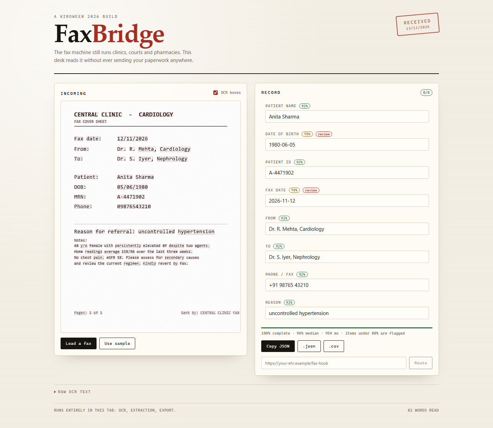

# Fax machines still run clinics. I built a reader that never uploads the page.

Plenty of clinics still run on a fax line. A referral arrives as a scanned
sheet, someone reads it, and someone retypes it into the EMR: name, date of
birth, MRN, who sent it, why. It is the same eight fields, over and over, and
the page itself is a photograph of private medical information.

The obvious build is "upload a PDF, run it through a cloud API". I did not want
that. A fax is the one document where the person handling it has the least
authority to send it somewhere new.

So FaxBridge runs the whole thing in the tab: the OCR engine, the parser, the
review screen, the export. Close the tab and nothing is left anywhere — not on a
server, not in a database, not in a log.



## What it produces

Eight fields come back per fax: patient name, date of birth, patient ID, fax
date, sender, recipient, phone, and reason for referral. Each one carries a
confidence score and can be edited before export. Then it leaves as JSON, CSV,
or a POST to a webhook you supply.

The number I care about is not "accuracy". It is how often the tool says
*"I am not sure"* instead of guessing.

## The pipeline

```
file ──► PDF rasteriser ──► tesseract worker ──► field parser ──► review ──► export
```

**Ingest.** Images go straight in. PDFs are rasterised at 2× on page 1 with
pdf.js, because a 150 dpi fax scan that has already been through a fax codec is
not something an OCR model can be picky about.

**Recognise.** Tesseract runs in a Web Worker. Every word comes back with a
bounding box, and the UI draws those boxes over the scan so you can see what the
machine actually read — which matters more than any percentage.

**Extract.** The parser works on lines, not on the whole page:

- `Patient: Anita Sharma` — labelled match, base score 0.92
- a bare date anywhere on the page — generic match, 0.55
- a bare 10-digit number — 0.50

Those bases are then multiplied by the page's median word confidence, clamped so
a terrible scan cannot drag a labelled match to zero. The result is one number
per field that means roughly what it says: how much of this value came from a
label, and how well did the page read.

**Review.** Anything under 0.8 is flagged. Nothing is silently overwritten.

## The trap I nearly shipped

`DOB: 05/06/1980`.

Is that 5 June or 6 May? The fax does not say. In the US it is May 6th; in India
it is the 5th of June. If the tool is 90% confident either way, the first wrong
record looks exactly like a right one.

So ambiguous slash dates resolve day-first, get scored 0.70 and carry a review
badge. A date that cannot exist (`31/02/1990`) resolves to nothing at all rather
than the closest legal date. It is the one place where a "smart" guess would be
invisible to the person signing off on the record, so the tool refuses to make
it.

That rule did not come from me being careful. It came from writing the
requirement down before the code.

## What Kiro actually changed

I used Kiro as the spec layer, not as an autocomplete. Everything specific to it
sits in `.kiro/` and is committed, because a hackathon repo where the AI tooling
is invisible is not much of a demonstration.

**Specs first.** `.kiro/specs/faxbridge/requirements.md` holds R1–R7 in EARS
form: ingest, recognise, extract, review, hand-off, privacy, demo. The design
document derives the module table and the confidence formula from those
requirements, and `tasks.md` is the checklist I worked down. Writing R3.3 as a
requirement — *"an ambiguous date must be flagged, never silently resolved"* —
is what forced the day-first decision above into the open. In a chat-driven
build that decision would have been made once, in passing, and never recorded.

**Steering.** Three files in `.kiro/steering/` — product, tech, structure. The
product one holds the non-negotiables: local by default, show uncertainty, no
silent date guessing, one page only. Because they are in the repo, they apply to
every later edit rather than to whichever session happened to remember them.

**Hooks.** `.kiro/hooks/` carries three:

| Hook | Trigger | Action |
| --- | --- | --- |
| `test-on-save` | a file under `src/` is edited | runs `npx vitest run` |
| `parser-guard` | `src/lib/extract.ts` is edited | asks the agent to review the diff against R3 |
| `spec-drift` | `requirements.md` is edited | asks the agent to reconcile `tasks.md` |

The parser guard is the useful one. `extract.ts` is the file where a small tidy
up can quietly change a confidence score, and nothing else in the project
notices. The hook makes that file the one place where a change has to be
justified.

**Custom agents.** `.kiro/agents/ocr-reviewer.json` checks extraction changes
against R3. `.kiro/agents/privacy-auditor.json` has one job: find anything that
moves fax content off the device — a `fetch`, a form post, an analytics call, a
CDN that sees the image. It is scoped to the export path and the webhook, which
are the only two places content could leave.

**MCP.** `mcp/fax-tools/server.mjs` is a dependency-free stdio server exposing
`normalize_date` and `validate_record`, registered in `.kiro/settings/mcp.json`.
It exists so date behaviour could be checked inside the agent loop instead of in
a scratch file I would forget to delete.

**Property-based testing.** Two fast-check properties cover the parsers: every
valid calendar day survives a write-then-read round trip, and the phone
normaliser refuses anything shorter than seven digits. Eight tests total, and
they run on every save thanks to the hook.

## What broke

Tesseract.js v7 does not return word data by default. My first build showed
correct field values with every confidence at 51% and a 0% page score, because
`data.blocks` was `undefined` and the confidence chain multiplied by nothing.
The fix is one argument — `recognize(canvas, {}, { blocks: true })` — but the
bug was invisible in the UI: the values looked right, so the percentages looked
like tesseract being pessimistic rather than the tool being broken. A tool whose
entire promise is calibrated uncertainty has to treat a confidence bug as a
correctness bug.

The lesson went into the code as a comment and into the steering file as a rule.

## Numbers, honestly

On the bundled sample referral: 82 words read, 96% median word confidence,
8/8 fields extracted, about 4.5 seconds warm in a desktop browser. Two fields
are flagged for review, both ambiguous slash dates, which is the system working
rather than failing.

## What it does not do

- **Page 1 only.** Multi-page filings need fields joined across pages.
- **English only.** The next step is Hindi and Marathi, because that is what
  arrives at a district hospital.
- **No storage.** Closing the tab loses the record. That is the privacy promise,
  not a missing feature.
- **CORS-bound webhooks.** A browser cannot POST to a server that does not allow
  it, so the UI says so instead of failing silently.

The interesting part of this build was not the OCR. It was deciding, in writing
and before the code, that the tool should sometimes refuse to answer.

Try it: <https://faxbridge-demo.web.app/?demo=1> — the sample runs itself and
nothing is uploaded.
